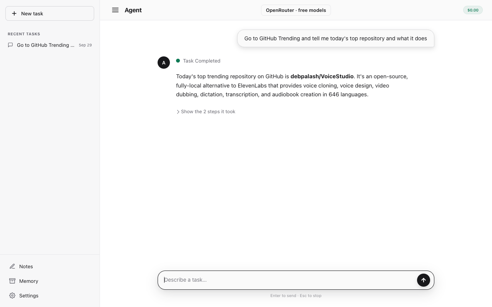
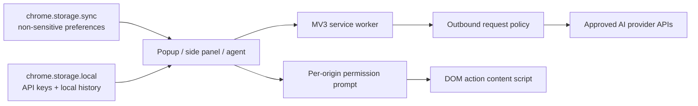

# Select to AI

[](https://github.com/arnav-goel10/select-to-ai/actions/workflows/ci.yml)
[](https://developer.chrome.com/docs/extensions/develop/migrate/what-is-mv3)
[](LICENSE)

Select to AI is a Chrome extension. Highlight text, right-click, and send it to ChatGPT, Gemini or Perplexity, or to Claude once you allow claude.ai. It also has a browser agent that runs on your own model provider and can save a run that worked as a recipe to replay later.



The published extension has served approximately 1,000 users. The count is intentionally approximate because it changes over time.

## Results

A recipe replays a saved run without calling a model while the pages look as recorded. It tries to repair a step whose control only moved or was restyled, and it stops before a press whose meaning changed. The table below is the third held-out benchmark, run once on 7 Nov 2026: 42 mutations of fixture pages, 192 runs per system, success judged only by what the fixture server recorded. It is copied from [docs/results-heldout-v3.md](docs/results-heldout-v3.md).

| System | Success, repairable | Repair coverage | Correct stop | False "done" | Wrong action | False heals | $/run | s/run |
|---|---|---|---|---|---|---|---|---|
| **Recipes (repair on Haiku 5.5)** | **77.2%** [69–84] | **55.6%** [42–68] | **100%** (30/30) | **0%** (0/192) | **0%** (0/192) | **0/20** | $0.00014 | 4.7 |
| Recipes, replay only | 36.8% | 14.8% | 100% | 0% | 0% | n/a | 0 | 3.4 |
| healwright (default) | 70.2% | 37.0% | 6.7% | 18.8% | 13.5% | 0/25 | $0.00014 | 2.5 |
| healwright (minConfidence 0.8) | 62.3% | 20.4% | 6.7% | 18.8% | 13.5% | 0/18 | $0.00011 | 2.2 |
| Plain replay (fixed selectors) | 52.6% | 0% | 6.7% | 18.8% | 13.5% | n/a | 0 | 2.1 |

healwright is a selector-healing tool used as the baseline. Limits stated in the same doc:

- The pages are fixture apps written by our own separate benchmark author, not real sites. The next proof has to be real portals and real users.
- Repair runs on Haiku 5.5 only. Other models are untested.
- There are 54 breaking cells, so the coverage interval is wide (42–68%).
- Commit buttons whose wording changed still stop for the user's approval, by design.

The earlier held-out sets are in [docs/results-heldout-v1.md](docs/results-heldout-v1.md) and [docs/results-heldout-v2.md](docs/results-heldout-v2.md). Each set was run once, then retired.

## Why it is different

- **One gesture to any assistant:** send selected text from the context menu to a side panel or new tab.
- **Provider-agnostic agent:** use OpenAI, Anthropic, OpenRouter, Gemini, DeepSeek, Mistral, Groq, Together, xAI, OpenCode, or an HTTPS/local custom gateway.
- **Human control:** a spending limit, a site allowlist and regular check-ins bound autonomous runs; sensitive actions require confirmation.
- **Local-first credentials:** API keys stay in `chrome.storage.local`, are removed from legacy sync storage, and are excluded from exports.
- **Least-privilege browsing:** websites are optional permissions. Allow the agent on all sites once, or one site at a time.
- **Tested request boundary:** every model request is restricted to a known provider or the exact configured custom-gateway origin.

## Quick start

Requirements: Chrome 120+ and Node.js 20+ for development checks.

1. Clone the repository.
2. Run `npm ci && npm run check`.
3. Open `chrome://extensions` and enable **Developer mode**.
4. Choose **Load unpacked** and select the repository's `extension/` directory.
5. The welcome page opens. Click **Continue with OpenRouter (free)** or paste an API key to turn on the agent.

No build step is required. The checked-in JavaScript is the extension source Chrome loads.

## Core workflows

### Send selected text

Select text on a webpage, right-click, choose **Select to AI**, then select an enabled assistant. The extension can open the assistant in a tab or its Chrome side panel and optionally submit the prompt. For new ChatGPT and Perplexity conversations with auto-send on, the prompt travels as a URL parameter, no DOM automation involved. Other inserts use per-provider selector chains that verify the send actually happened; if no selector matches, your text is copied to the clipboard and a toast tells you so, instead of the extension clicking a guessed button.

### Use the popup

The toolbar popup is a task box for the agent (with one-tap ideas: summarize, cheapest option, compare my tabs), plus **Chat in the side panel**, **Open the agent in a tab** and **Quick box**, each with its shortcut. Every preference lives in **Settings**, one page with four sections. Settings save only what you change, so improved defaults reach everyone who has not chosen otherwise.

### Run the browser agent

Open the **agent** (`Alt+A`, or `Control+Shift+G` on macOS, the popup button, the side panel dropdown or the quick box), say what you want, and watch it work. There is one agent and one way it runs, whatever you ask: it decides for itself whether the request is a question about the page, a site to open, or a task to carry out.

1. **See the page:** every control on the page is listed for the model with what is new since the last step, inside a budget fitted by the page's structure.
2. **Act like a person:** each step is one `step` tool call with the agent's notes, the goal of the step and the actions to take (press, fill, go to, read); the extension presses and types on the page, and the result says what the page did.
3. **Stay safe:** a fixed policy in code decides whether each action runs, waits for your approval, is handed to you (a sign-in, a human check, a code, the button that pays) or is refused. Passwords, card numbers and codes are never typed by the agent.
4. **Check the answer:** the answer's quotes are checked against what the agent was shown, and a multi-step answer gets a second look by a fresh model call. Its opinion is shown under the answer.

The run lives in the service worker, so closing the side panel loses nothing; reopen it and the run is still there. It asks you when it needs you (a sign-in, a human check, a choice only you can make) and carries on once that is done, and it says plainly what it could not do instead of making a result up. While a run works you can send it a message that it reads before its next step, save the run's steps as Markdown, and stop it at any time.

New installs open a short welcome page. Highlight-to-ask works straight away; to turn the agent on, click **Continue with OpenRouter (free)** (sign in, and a key is created for you) or paste any provider key, which is recognised from its prefix and tested before it is saved. The default model is OpenRouter's free router (`openrouter/free`), so the agent works without a card. The first time the agent needs a website, choose **Allow on all sites** (one prompt, ever) or **Only this site**. Before the first request to a provider, the agent shows once what it sends and to whom, and waits for your yes. Keep **Ask before purchases, payments and deletions** on.

### Use the quick box

The quick box (`Control+Shift+Q` on macOS, `Alt+K` elsewhere) works from any page: what you type, with any text you had selected, starts the agent on that tab. With the agent turned off, it opens the setup page and keeps what you typed. Agent tasks still stop at the risk-confirmation gate before any consequential action.

### Use a custom gateway

In Settings, under Browser agent, choose **Change**, then **Your own server (OpenAI-compatible)** and enter its address. Remote gateways must use HTTPS; HTTP is accepted only on `localhost` or `127.0.0.1`. Requests are origin-bound to the configured gateway.

## Architecture



See [Architecture](docs/architecture.md) and [Security model](docs/security.md) for boundaries and design decisions.

## How it is tested

```bash
npm run check          # syntax, unit tests, security benchmark, page-reader and end-to-end checks (CI-required)
npm test               # Node test runner
npm run benchmark      # deterministic outbound-policy evaluation
npm run test:v4        # the agent's scripted end-to-end scenarios (also run by check)
```

The benchmark covers approved endpoints, look-alike domains, exfiltration targets, unsafe schemes, local gateways, and origin mismatches. CI runs the same clean-install command on every pull request.

`npm run test:v4` is the end-to-end receipt: it launches Chromium with the unpacked extension, points the agent at a scripted OpenAI-compatible gateway on `127.0.0.1` (`tests/e2e/server.js`, the same loopback path a real local gateway uses), and drives every scenario through the real engine: the run in the service worker, the page actions, the safety policy, the waits for the user, and the panel as a view. The harness plays the user where a scenario needs one: it approves or declines, signs in on the page, answers a question, closes the panel and opens it again. `E2E_ONLY=signin,form` runs a subset; `E2E_HEADFUL=1` shows the browser. The manual **E2E agent harness** GitHub workflow runs it in a visible browser.

### Decision eval

The e2e harness proves the pipeline works; the decision eval measures whether the agent picks the right next step. `tests/decisions/cases.js` holds 55 situations (a blank tab, a search box, a cookie banner, a login wall, a CAPTCHA, a form with a dropdown, a step that just failed, "compare these two tabs", selected text, and more). `npm run eval:capture` reads each page with the extension's real page reader in headless Chromium and saves what the agent would see; `npm run eval:decisions` then puts each case to a model the way the engine does (its instructions, its `step` tool, its checks) and scores the step it chooses. No browser, a couple of minutes per run.

```bash
DECISION_API_KEY=sk-or-... DECISION_REPEAT=2 npm run eval:decisions
```

| Variable | Effect |
| --- | --- |
| `DECISION_BASE_URL`, `DECISION_MODEL` | Any OpenAI-compatible provider and model (default OpenRouter, `openrouter/free`). |
| `DECISION_ONLY=safety,form` | Run some cases or categories. |
| `DECISION_INSTRUCTIONS_FILE=variant.txt` | A/B rewritten instructions against the built-in ones on the same cases. |
| `DECISION_REPORT=report.json` | Write every decision as JSON. |
| `DECISION_DRY=1` | No model: check each case's answer actually reaches the prompt. |

### Page-reader check

`npm run eval:reading-wild` checks the page reader on 46 real pages it was never tuned on (tests/reading/wild-sites.js), with Mozilla Readability as the judge of what each page's content is and no model: content kept, share of on-topic text, whether in-page search finds sentences picked at random positions, and the size of the element list. `WILD_OLD=<git ref>` compares with an older reader.

## Permissions

| Permission | Purpose |
| --- | --- |
| `contextMenus` | Add the right-click menu for selected text. |
| `storage` | Keep preferences, API keys (local only) and the agent's task memory. |
| `sidePanel` | Show the chosen assistant or the agent beside the page. |
| `tabs`, `activeTab`, `scripting` | Read and act on the tab you choose. |
| `declarativeNetRequest` | Let the supported assistant sites load inside the side panel. The rule covers only those sites and only the side panel, never ordinary tabs. |
| `identity` | Run the OpenRouter sign-in from the welcome page, which creates a key for you. |
| `alarms` | Resume a paused run on time, send one reminder when a run waits for you, and keep the service worker awake while a run is busy. |
| `idle` | Tell whether you are away, so a waiting run notifies you only then. |
| `notifications` (optional) | Notify you when a run finishes or needs you. Asked when you set up the agent, and never needed for right-click sending. |
| `chatgpt.com`, `gemini.google.com`, `www.perplexity.ai` | Put your text into the assistant you picked. These are the same sites 2.0 used. |
| Other sites (optional) | Asked the first time a feature needs them: claude.ai for sending to Claude, your model provider for the agent, and the sites you let the agent work on, one at a time or all at once. |

Version 4.0 adds no permission warning for someone updating from 2.0. CI checks this on every change with Chrome's own warning list ([tests/contract](tests/contract)). It also ships without `debugger`, so the agent presses and types through page scripts; [docs/debugger-permission.md](docs/debugger-permission.md) says what that costs.

## Repository guide

- `extension/`: the complete build-free Manifest V3 package loaded by Chrome.
- `tests/unit/`: dependency-free policy and storage regression tests.
- `tests/benchmark/`: deterministic adversarial request-policy evaluation.
- `tests/e2e/`: the puppeteer harnesses (scripted gateway, fixture pages, the agent's end-to-end scenarios, page-reader and widget checks).
- `scripts/`: repository validation tooling.
- `docs/`: architecture and security design documentation.
- [`docs/provenance.md`](docs/provenance.md): project origin, attribution, and Arnav Goel's contribution.

## Contributing

Read [CONTRIBUTING.md](CONTRIBUTING.md). Please report vulnerabilities privately using [SECURITY.md](SECURITY.md), not a public issue.

## Privacy and license

Read the plain-language [Privacy Policy](PRIVACY_POLICY.md). Select to AI is available under the [MIT License](LICENSE).
