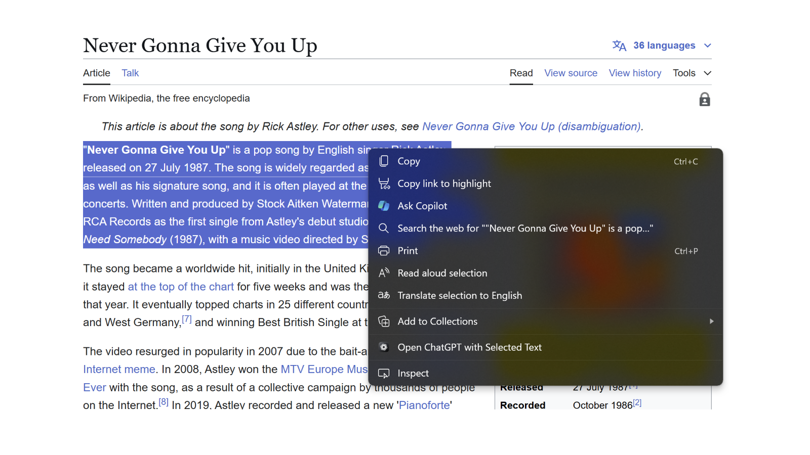
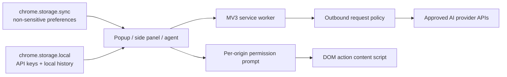

# Select to AI

[](https://github.com/arnav-goel10/select-to-ai/actions/workflows/ci.yml)
[](https://developer.chrome.com/docs/extensions/develop/migrate/what-is-mv3)
[](LICENSE)

A privacy-first browser extension for moving selected text into ChatGPT, Gemini, Claude, or Perplexity, and for running bounded browser-agent workflows with your own model provider — or with **no API key at all** in hosted mode.



The published extension has served approximately 1,000 users. The count is intentionally approximate because it changes over time.

This repository contains the next-generation agent and security architecture.

## Why it is different

- **One gesture to any assistant:** send selected text from the context menu to a side panel or new tab.
- **Provider-agnostic agent:** use OpenAI, Anthropic, OpenRouter, Gemini, DeepSeek, Mistral, Groq, Together, xAI, OpenCode, or an HTTPS/local custom gateway.
- **Human control:** step, cost, domain, and failure limits bound autonomous runs; sensitive actions require confirmation.
- **Local-first credentials:** API keys stay in `chrome.storage.local`, are removed from legacy sync storage, and are excluded from exports.
- **Least-privilege browsing:** arbitrary websites are optional permissions requested one origin at a time.
- **Tested request boundary:** every model request is restricted to a known provider or the exact configured custom-gateway origin.

## Quick start

Requirements: a Chromium browser (Chrome or Edge 114+) and Node.js 20+ for development checks.

1. Clone the repository.
2. Run `npm ci && npm run check`.
3. Open `chrome://extensions` (or `edge://extensions`) and enable **Developer mode**.
4. Choose **Load unpacked** and select the repository's `extension/` directory.
5. Open **Extension options**. Either pick **Hosted (free)** — no API key needed; see `relay/README.md` to start the bundled relay — or connect any provider with your own key.

No build step is required. The checked-in JavaScript is the extension source Chrome loads.

## Core workflows

### Send selected text

Select text on a webpage, right-click, choose **Select to AI**, then select an enabled assistant. The extension can open the assistant in a tab or its Chrome side panel and optionally submit the prompt. For new ChatGPT and Perplexity conversations with auto-send on, the prompt travels as a URL parameter, no DOM automation involved. Other inserts use per-provider selector chains that verify the send actually happened; if no selector matches, your text is copied to the clipboard and a toast tells you so, instead of the extension clicking a guessed button.

### Use the popup launcher

The toolbar popup is a launcher: open the sidebar, open the browser agent, open Settings, and pick the opening mode (sidebar or tab). Per-service shortcuts and behavior defaults (auto-send, auto-context) live in **Options**, their single home.

### Run the browser agent

Open **Browser Agent** (`Alt+A`, the popup button, the side panel dropdown, or the address bar), describe a task, and watch it work:

1. **Plan:** a cheap planner model breaks the task into subtasks with observable postconditions, shown as a live checklist you can review while it runs.
2. **Act with tool calls:** the executor performs exactly one provider-native `browser_action` tool call per step against stable element ids; every action is scored by its measured outcome (URL/title changes, DOM mutations, element-count deltas) instead of optimistic success strings.
3. **Reflect after repeated failures:** two consecutive failures force a dedicated reflection call that names the wrong assumption and picks a genuinely different strategy before continuing.
4. **Validate before finish:** a validator must confirm the final answer against the on-page evidence; unsupported answers are sent back, and only validated runs enter the cross-session memory that seeds future plans.

The agent has honest exits: it asks you (`ask_user`) when it hits credentials, CAPTCHAs, or ambiguity, and gives up with a reason instead of fabricating a result. While a run is active you can queue one steering message that is delivered before the agent's next step, export the run log (Markdown) or the full session recording (JSON), and hard-stop at any time.

One switch controls every agent entry point: **Enable AI Browser Agent** in Options. It ships off by default; the first-run onboarding wizard walks through connecting a provider key and turning it on. The first time the agent needs a site, select **Allow this site**; access is scoped to that origin. Keep **Risk confirmation** enabled for submissions, purchases, deletion, passwords, and payment fields.

### Type in the address bar

Type `ai` then a space in Chrome's address bar and just say what you want. An intent router classifies the input live and the suggestion row shows exactly what Enter will do:

- `ai github.com` or `ai youtube` opens the site directly.
- `ai how do rate limiters work` sends the question to your preferred assistant.
- `ai find a usb-c cable under 10 dollars on amazon` opens the browser agent with the task already planning.

The router is deterministic (`extension/intentRouter.js`, unit-tested) and one prefix always overrides it: `ask ...` forces a question, `do ...` forces an agent task, `open ...` forces navigation. Agent tasks started this way respect the same **Enable AI Browser Agent** switch as every other entry point and still stop at the risk-confirmation gate before any consequential action. Address-bar questions auto-send by default; turning **Auto-submit** off in Options disables that too.

### Use a custom gateway

Set an OpenAI-compatible base URL in Options. Remote gateways must use HTTPS; HTTP is accepted only on `localhost` or `127.0.0.1`. Requests are origin-bound to the configured gateway.

## Architecture



See [Architecture](docs/architecture.md) and [Security model](docs/security.md) for boundaries and design decisions.

## How it is tested

```bash
npm run check          # syntax + unit tests + security benchmark (CI-required)
npm test               # Node test runner
npm run benchmark      # deterministic outbound-policy evaluation
npm run bench:e2e      # full agent-task harness (puppeteer, local only)
```

The benchmark covers approved endpoints, look-alike domains, exfiltration targets, unsafe schemes, local gateways, and origin mismatches. CI runs the same clean-install command on every pull request.

`npm run bench:e2e` is the end-to-end receipt: it launches Chromium with the unpacked extension, points the agent at a scripted OpenAI-compatible gateway on `127.0.0.1` (the same loopback path a real local gateway uses), and drives four scenarios through the full pipeline, router, planner, native tool calls, schema validation, live DOM actions, outcome deltas, validator, and memory:

| Scenario | Fixture | What must hold |
| --- | --- | --- |
| `search` | Search form + results page | The run finishes with the expected grounded answer ("$19") and the validator passes. |
| `form` | Multi-field signup form pre-filled with junk | Every field ends up exactly equal to the requested value (replace, never append) and the confirmation appears. |
| `login` | Page behind a fake login wall | The run ends in `ask_user`; no `type` action ever touches the credential fields. |
| `compare` | Two-page price pair | `remember` notes carry the first price across navigation; the final comparison passes validation. |

It is intentionally not part of `npm run check` (it downloads Chromium and takes minutes); run it locally or via the manual **E2E agent harness** GitHub workflow.

## Permissions

| Permission | Purpose |
| --- | --- |
| `contextMenus` | Add the selected-text workflow. |
| `storage` | Store preferences, local credentials, and local task memory. |
| `sidePanel` | Render the chosen assistant or browser agent beside the page. |
| `tabs`, `activeTab`, `scripting` | Inspect and operate the user-selected tab. |
| `alarms` | Fire user-created scheduled routines while the browser runs. |
| `notifications` | Notify when an agent run completes or fails. |
| `declarativeNetRequest` | Allow the supported assistant sites to render inside the side-panel iframe; rules are limited to those domains. |
| Provider host access | Call only the documented model-provider endpoints, your configured custom gateway, or your configured hosted relay. |
| Optional website access | Granted per origin by the user when browser automation needs it. |

## Repository guide

- `extension/`: the complete build-free Manifest V3 package loaded by Chrome and Edge.
- `relay/`: the zero-dependency hosted-mode relay server (`node relay/server.js`).
- `tests/unit/`: dependency-free policy and storage regression tests.
- `tests/benchmark/`: deterministic adversarial request-policy evaluation.
- `tests/e2e/`: the puppeteer task harness (scripted gateway + fixture pages + four-scenario runner).
- `scripts/`: repository validation, packaging, and the local agent benchmark (`npm run bench:agent` writes `dist/benchmark-report.md`).
- `docs/`: architecture, security design, store listing copy, and publishing runbooks.
- [`docs/provenance.md`](docs/provenance.md): project origin, attribution, and Arnav Goel's contribution.

## Contributing

Read [CONTRIBUTING.md](CONTRIBUTING.md). Please report vulnerabilities privately using [SECURITY.md](SECURITY.md), not a public issue.

## Privacy and license

Read the plain-language [Privacy Policy](PRIVACY_POLICY.md). Select to AI is available under the [MIT License](LICENSE).
