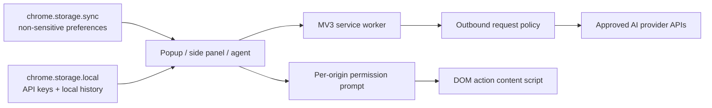

# Select to AI

[](https://github.com/arnav-goel10/select-to-ai/actions/workflows/ci.yml)
[](https://developer.chrome.com/docs/extensions/develop/migrate/what-is-mv3)
[](LICENSE)

A privacy-first Chrome extension for moving selected text into ChatGPT, Gemini, Claude, or Perplexity, and for running bounded browser-agent workflows with your own model provider.


The published extension has served approximately 1,000 users. The count is intentionally approximate because it changes over time.

This repository contains the next-generation agent and security architecture.

## Why it is different

- **One gesture to any assistant:** send selected text from the context menu to a side panel or new tab.
- **Provider-agnostic agent:** use OpenAI, Anthropic, OpenRouter, Gemini, DeepSeek, Mistral, Groq, Together, xAI, OpenCode, or an HTTPS/local custom gateway.
- **Human control:** step, cost, domain, and failure limits bound autonomous runs; sensitive actions require confirmation.
- **Local-first credentials:** API keys stay in `chrome.storage.local`, are removed from legacy sync storage, and are excluded from exports.
- **Least-privilege browsing:** arbitrary websites are optional permissions requested one origin at a time.
- **Tested request boundary:** every model request is restricted to a known provider or the exact configured custom-gateway origin.

## Quick start

Requirements: Chrome 114+ and Node.js 20+ for development checks.

1. Clone the repository.
2. Run `npm ci && npm run check`.
3. Open `chrome://extensions` and enable **Developer mode**.
4. Choose **Load unpacked** and select the repository's `extension/` directory.
5. Open **Extension options**, choose a provider, and add your API key.

No build step is required. The checked-in JavaScript is the extension source Chrome loads.

## Core workflows

### Send selected text

Select text on a webpage, right-click, choose **Select to AI**, then select an enabled assistant. The extension can open the assistant in a tab or its Chrome side panel and optionally submit the prompt.

### Run the browser agent

Open **Browser Agent** (`Alt+A` by default), describe a task, and review its live plan and action log. The first time it needs to interact with a site, select **Allow this site**; access is scoped to that origin. Keep **Risk confirmation** enabled for submissions, purchases, deletion, passwords, and payment fields.

### Type in the address bar

Type `ai` then a space in Chrome's address bar and just say what you want. An intent router classifies the input live and the suggestion row shows exactly what Enter will do:

- `ai github.com` or `ai youtube` opens the site directly.
- `ai how do rate limiters work` sends the question to your preferred assistant.
- `ai find a usb-c cable under 10 dollars on amazon` opens the browser agent with the task already planning.

The router is deterministic (`extension/intentRouter.js`, unit-tested) and one prefix always overrides it: `ask ...` forces a question, `do ...` forces an agent task, `open ...` forces navigation. Agent tasks started this way still stop at the risk-confirmation gate before any consequential action.

### Use a custom gateway

Set an OpenAI-compatible base URL in Options. Remote gateways must use HTTPS; HTTP is accepted only on `localhost` or `127.0.0.1`. Requests are origin-bound to the configured gateway.

## Architecture



See [Architecture](docs/architecture.md) and [Security model](docs/security.md) for boundaries and design decisions.

## Verification

```bash
npm run check          # syntax + unit tests + security benchmark
npm test               # Node test runner
npm run benchmark      # deterministic outbound-policy evaluation
```

The benchmark covers approved endpoints, look-alike domains, exfiltration targets, unsafe schemes, local gateways, and origin mismatches. CI runs the same clean-install command on every pull request.

## Permissions

| Permission | Purpose |
| --- | --- |
| `contextMenus` | Add the selected-text workflow. |
| `storage` | Store preferences, local credentials, and local task memory. |
| `sidePanel` | Render the chosen assistant or browser agent beside the page. |
| `tabs`, `activeTab`, `scripting` | Inspect and operate the user-selected tab. |
| `notifications` | Notify when an agent run completes or fails. |
| `declarativeNetRequest` | Allow the supported assistant sites to render inside the side-panel iframe; rules are limited to those domains. |
| Provider host access | Call only the documented model-provider endpoints. |
| Optional website access | Granted per origin by the user when browser automation needs it. |

## Repository guide

- `extension/`: the complete build-free Manifest V3 package loaded by Chrome.
- `tests/unit/`: dependency-free policy and storage regression tests.
- `tests/benchmark/`: deterministic adversarial request-policy evaluation.
- `scripts/`: repository validation tooling.
- `docs/`: architecture and security design documentation.
- [`docs/provenance.md`](docs/provenance.md): project origin, attribution, and Arnav Goel's contribution.

## Contributing

Read [CONTRIBUTING.md](CONTRIBUTING.md). Please report vulnerabilities privately using [SECURITY.md](SECURITY.md), not a public issue.

## Privacy and license

Read the plain-language [Privacy Policy](PRIVACY_POLICY.md). Select to AI is available under the [MIT License](LICENSE).
